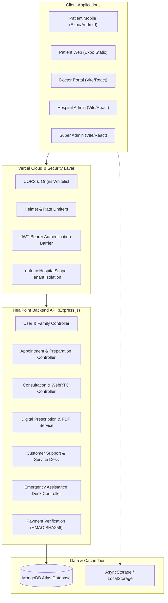
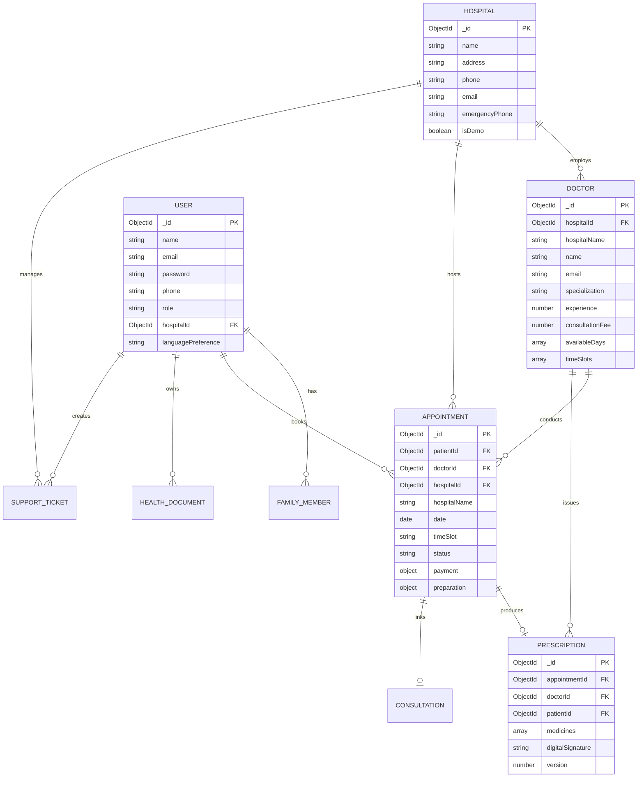

# Anand HealPoint — Final Project & College Presentation Dossier
## Comprehensive Engineering Documentation, System Architecture, ER Design & Viva Guide

---

## 1. Project Introduction & Overview
**Anand HealPoint** is a multi-tenant, four-portal healthcare appointment and clinical workflow ecosystem developed for academic defense, portfolio demonstration, and system architecture evaluation. The platform bridges patient discovery, appointment booking, digital prescriptions, in-app telemedicine consultations, and administrative governance across independent hospital franchises.

### Key Highlights
- **Architecture**: Distributed MERN Stack + React Native / Expo Native Mobile Client + Web Portals.
- **Portals**:
  1. **Patient Mobile & Web Application**: Cross-platform Expo SDK 54 client with tri-lingual localization (English, Hindi, Gujarati), offline capabilities, and Health Wallet.
  2. **Doctor Portal (`HealPointDoctorWeb`)**: Vite + React workspace for clinical schedules, patient history, WebRTC video consultations, and digital prescription issuance.
  3. **Hospital Admin Portal (`HealPointHospitalAdminWeb`)**: Hospital-scoped operations, doctor credentialing, department metrics, and revenue reconciliation.
  4. **Super Admin Portal (`HealPointSuperAdminWeb`)**: Platform-wide telemetry, hospital onboarding, global audit logs, and service reliability controls.

---

## 2. Problem Statement & Objectives
### The Problem
Traditional outpatient departments (OPD) in multi-hospital metropolitan zones suffer from:
1. Fragmented patient medical history across disparate hospitals.
2. High waiting times and opaque queue status in waiting halls.
3. Unorganized paper prescriptions prone to misplacement or handwriting ambiguity.
4. Lack of tenant isolation in centralized healthcare platforms, causing cross-facility data leakage.

### System Objectives
- **Centralized Discovery with Multi-Tenant Isolation**: Allow patients to book across multiple hospitals while guaranteeing strict multi-tenant authorization barriers.
- **Digital Health Continuity**: Aggregate prescriptions, lab reports, and medication reminders into an encrypted, patient-owned Health Wallet.
- **Real-Time Video Consultations**: Integrated WebRTC peer-to-peer consultation rooms with socket-based tokenized signaling.
- **Offline Resilience & Accessibility**: Seamless cached data access during network intermittency and WCAG 2.1 accessible touch targets and focus outlines.

---

## 3. Technology Stack & Frameworks

| Tier | Technologies / Libraries |
|---|---|
| **Mobile & Patient Web** | React Native, Expo SDK 54, Expo Router (file-based), TypeScript, React Context, AsyncStorage |
| **Doctor Portal Web** | React 18, Vite 5, React Router DOM, React-Toastify, Axios, Tailwind CSS |
| **Hospital Admin Web** | React 18, Vite 5, React-Icons, Chart.js, HTML5 Canvas, PDFKit client integration |
| **Super Admin Web** | React 18, Vite 7, Recharts, React-Hot-Toast, Lucide Icons, Socket.IO Client |
| **Backend API** | Node.js (v24), Express.js (ESM), Socket.IO, Helmet, Morgan, Winston, PDFKit |
| **Database** | MongoDB Atlas, Mongoose ODM, Compound Indexes, Automated JSON Snapshotting |
| **Deployment / CI** | Vercel Serverless (Production Backend + 4 Frontend Portals), GitHub Version Control |

---

## 4. System Architecture Diagram



---

## 5. Entity-Relationship (ER) & Schema Design



---

## 6. Key Workflows & Demonstration Procedures

### Workflow 1: Patient Appointment Booking & Preparation
1. **Discovery**: Patient navigates to Home screen or Doctors directory, filtering by specialization (e.g. Cardiologist, Dermatologist) or Hospital.
2. **Slot Selection**: Selects date and interactive time slot calculated via backend slot availability engine.
3. **Checkout & Confirmation**: Simulates payment transaction with HMAC signature verification; booking status transitions to `confirmed`.
4. **Pre-Consultation Center**: Patient navigates to `/appointment/prepare/:id` to answer clinical prep questions and complete fasting/document checklists.

### Workflow 2: Doctor Clinical Session & Digital Prescription
1. **Authentication**: Doctor logs into `https://heal-point-doctor-web.vercel.app`.
2. **Dashboard Review**: Views today's queued patients and appointment timeline.
3. **Prescription Authoring**: Generates prescription draft detailing dosage schedule (`1-0-1`), duration, and clinical notes.
4. **Digital Cryptographic Signing**: Doctor signs prescription; system increments version, stores audit snapshot, and generates binary PDF buffer via PDFKit.

### Workflow 3: Hospital Admin Multi-Tenant Governance
1. **Authentication**: Admin logs into `https://heal-point-hospital-admin.vercel.app`.
2. **Isolation Enforcement**: Backend `enforceHospitalScope` middleware guarantees queries filter strictly by `req.user.hospitalId`.
3. **Operations**: Manage on-duty doctors, review appointments, track hospital revenues, and resolve patient support tickets.

### Workflow 4: Super Admin Platform Telemetry
1. **Authentication**: Super Admin logs into `https://heal-point-super-admin.vercel.app`.
2. **Platform KPI Dashboard**: Global overview of 7 hospitals, 79 doctors, registered patients, and appointment completion rates.
3. **Audit Trail**: Real-time review of audit logs and service health status.

---

## 7. Security Architecture & Isolation Controls
1. **Role-Based Access Control (RBAC)**: Tokenized JWT payload encodes `id`, `role`, and `hospitalId`.
2. **Tenant Boundary Enforcement**:
   ```javascript
   // HealPointBackend/middlewares/authMiddlewares.js
   export const enforceHospitalScope = (req, res, next) => {
     if (req.user && req.user.role === "hospital_admin") {
       req.query.hospitalId = req.user.hospitalId;
     }
     next();
   };
   ```
3. **Data Sanitization & Injection Prevention**: Mongoose strict schemas with input parameter validation on ObjectIds.
4. **Simulated Transaction Containment**: Zero live payments or external emergency telephony; backend feature flags (`DEMO_MODE`, `isDemo`, `isSimulation`) guarantee contained internal operations.

---

## 8. Verification & Test Evidence
- **Automated Test Suite**: 225/225 tests passing across 17 test suites (`npm test` in `HealPointBackend`).
- **Static Type Checking**: `npx tsc --noEmit` passing with 0 errors.
- **Expo Doctor Audit**: Passed 18/18 dependency and manifest checks.
- **Live Deployment Probes**: 100% HTTP 200 OK across all production endpoints.

---

## 9. Viva / Defense Q&A Cheatsheet for College Evaluators

**Q1: How does HealPoint ensure one hospital cannot view another hospital's patients?**  
*Answer*: The system enforces tenant isolation at both the database and routing levels. Hospital Admins are linked to a specific `hospitalId` in their JWT. The `enforceHospitalScope` middleware automatically binds this `hospitalId` to all query filters before execution, preventing horizontal privilege escalation.

**Q2: What happens when the patient goes offline?**  
*Answer*: The mobile app utilizes `use-network` to detect loss of connectivity. It renders a clean, non-intrusive status banner while continuing to display authorized cached data from local persistence storage. Dangerous mutations like payments or booking submissions are safely guarded with instant user feedback.

**Q3: How does the Pre-Consultation Center work?**  
*Answer*: The backend exposes dedicated REST routes (`/api/v1/appointment/preparation/:id`) to fetch and store patient questionnaire responses and readiness checklists directly inside the `appointmentModel.preparation` document schema.

**Q4: How are digital prescriptions verified?**  
*Answer*: Each issued prescription generates a cryptographic digital signature hash combining doctor credentials, timestamp, and prescription content. In-app and PDF exports include this digital stamp alongside version tracking.
