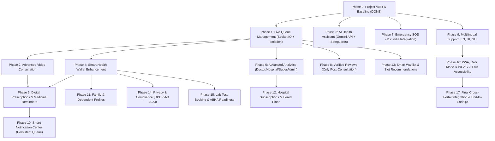

# HealPoint 2.0 — Dependency-Aware Implementation Plan

**Date:** 2026-10-31  
**Execution Strategy:** Sequential, Non-Destructive, Phase-by-Phase with Git Branches & Feature Flags

---

## 1. Roadmap & Phase Dependencies

---

## 2. Phase Breakdown & Execution Protocol

### Phase 0: Full Project Audit (COMPLETED)
- **Status**: Finished. Baseline tests recorded (7 backend tests pass, 0 TS errors). Audit reports generated.
- **Git Branch**: `main`

---

### Phase 1: Live Queue Management
- **Git Branch**: `phase-1-live-queue`
- **Feature Flag**: `FEATURE_LIVE_QUEUE=true`
- **Scope**:
  1. Initialize `socket.io` on `HealPointBackend/server.js` using the existing HTTP server.
  2. Implement Redis adapter support (`@socket.io/redis-adapter`) with safe in-memory fallback for single-node development.
  3. Scope rooms strictly to `hospital:${hospitalId}`, `doctor:${doctorId}`, and `user:${userId}`. Hospital Admin A can never join or receive events from Hospital B.
  4. Real-time patient updates: queue token, position in line, estimated wait time calculation based on real doctor consultation tempo.
  5. Real-time doctor actions: call patient, start consultation, complete consultation, mark no-show.
  6. Real-time hospital admin view: hospital-wide live queue overview and monitor.
- **Testing**:
  - Unit tests for queue calculation and atomic status transitions.
  - Integration test for Socket.IO connection and hospital room isolation.

---

### Phase 2: Advanced Video Consultation
- **Git Branch**: `phase-2-video-consultation`
- **Feature Flag**: `FEATURE_ADVANCED_VIDEO=true`
- **Scope**:
  1. Appointment-bound short-lived session authentication tokens.
  2. Integrated WebRTC / secure video consultation flow with audio/video controls.
  3. Doctor & patient waiting room state machine (`waiting`, `doctor_ready`, `in_consultation`, `completed`).
  4. Automatic consultation start and end timestamps.
  5. Post-consultation direct hand-off to prescription creation.
- **Testing**:
  - Token validation tests, expiry verification, and state transition integrity.

---

### Phase 3: AI Health Assistant
- **Git Branch**: `phase-3-ai-health-assistant`
- **Feature Flag**: `FEATURE_GEMINI_AI=true`
- **Scope**:
  1. Upgrade `aiController.js` to integrate official Google Gen AI SDK (`@google/genai`).
  2. Strict medical disclaimer and non-diagnostic guardrails.
  3. Indian emergency escalation: automatically triggers alert card with direct call to **112** for acute symptoms.
  4. Symptom-based doctor speciality recommendation querying actual active MongoDB doctors.
  5. Rate-limiting and prompt-injection defense; PHI sanitization before API dispatch.
- **Testing**:
  - Emergency keyword triggers, prompt injection resistance tests, disclaimer presence validation.

---

### Phase 4: Smart Health Wallet
- **Git Branch**: `phase-4-smart-health-wallet`
- **Feature Flag**: `FEATURE_HEALTH_WALLET=true`
- **Scope**:
  1. Enhance existing 3,010-line `health-wallet.tsx` and `appointmentController.js/getHealthWallet`.
  2. Pre-signed private storage upload and download URLs for medical reports and PDFs.
  3. Granular, time-limited, revocable doctor access consent.
  4. Multi-tenant access controls: Hospital Admins can only view records generated in their hospital; Super Admins cannot access private patient medical documents.
- **Testing**:
  - Document access authorization tests, token revocation verification.

---

### Phase 5: Digital Prescription and Medicine Reminders
- **Git Branch**: `phase-5-digital-prescription`
- **Feature Flag**: `FEATURE_DIGITAL_PRESCRIPTION=true`
- **Scope**:
  1. Doctor digital prescription builder (medicines, dosages, frequencies, food instructions, duration, clinical notes).
  2. High-fidelity downloadable PDF prescription generation using jsPDF with hospital branding and doctor registration details.
  3. Patient medication reminder management: mark doses taken/skipped, local notifications with timezone awareness (store UTC, display IST).
- **Testing**:
  - Prescription schema validation, PDF generation smoke test, dose status persistence tests.

---

### Phase 6: Advanced Analytics
- **Git Branch**: `phase-6-advanced-analytics`
- **Feature Flag**: `FEATURE_ADVANCED_ANALYTICS=true`
- **Scope**:
  1. High-performance MongoDB aggregation pipelines for Doctor earnings and appointment trends.
  2. Hospital Admin analytics: revenue, doctor performance, cancellation and no-show rates.
  3. Super Admin platform-wide trends and subscription revenue.
  4. CSV and PDF report export with strict hospital data boundaries.
- **Testing**:
  - Aggregation pipeline benchmark tests and hospital-scoped query verification.

---

### Phase 7: Emergency SOS
- **Git Branch**: `phase-7-emergency-sos`
- **Feature Flag**: `FEATURE_EMERGENCY_SOS=true`
- **Scope**:
  1. Enhance existing `emergency.tsx` screen: One-tap calling to **112** (India National Emergency) and primary emergency contact.
  2. Geolocation capture only with explicit user permission.
  3. Offline fallback cards for when GPS or network connectivity is unavailable.
- **Testing**:
  - Geolocation permission tests and fallback trigger tests.

---

### Phase 8: Verified Reviews and Feedback
- **Git Branch**: `phase-8-verified-reviews`
- **Feature Flag**: `FEATURE_VERIFIED_REVIEWS=true`
- **Scope**:
  1. Review submission permitted strictly after `appointment.status === 'completed'`.
  2. Prevention of duplicate reviews (one review per appointment record).
  3. Hospital and Doctor review moderation dashboard for authorized admins.
- **Testing**:
  - Uncompleted appointment review rejection tests, duplicate review block tests.

---

### Phase 9: Multilingual Support (English, Hindi, Gujarati)
- **Git Branch**: `phase-9-multilingual`
- **Feature Flag**: `FEATURE_MULTILINGUAL=true`
- **Scope**:
  1. Centralized i18n dictionary system across all portals.
  2. Supported languages: English (`en`), Hindi (`hi`), Gujarati (`gu`).
  3. Persistent user language preferences stored in DB and client storage.
  4. Proper Unicode support without corrupting proper nouns (doctor names, hospital names, medicine names).
- **Testing**:
  - Translation string lookup tests and script rendering tests.

---

### Phase 10: Smart Notification Center
- **Git Branch**: `phase-10-smart-notifications`
- **Feature Flag**: `FEATURE_SMART_NOTIFICATIONS=true`
- **Scope**:
  1. Centralized notification dispatcher across in-app, push, and email.
  2. Persistent queue architecture with retry backoff and idempotency keys to prevent duplicate emails/SMS.
  3. User notification preference settings per channel and event category.
- **Testing**:
  - Idempotency key tests, retry backoff tests, preference filtering tests.

---

### Phase 11: Family & Dependent Profiles
- **Git Branch**: `phase-11-family-profiles`
- **Feature Flag**: `FEATURE_FAMILY_PROFILES=true`
- **Scope**:
  1. Full isolation of dependent Health Wallets, appointments, and prescriptions under primary user account.
  2. Appointment booking on behalf of family members.
  3. Stricter access rules for minor and senior citizen records.
- **Testing**:
  - Dependent record isolation tests and cross-dependent access prevention tests.

---

### Phase 12: Hospital Subscriptions & Tiered Plans
- **Git Branch**: `phase-12-hospital-subscriptions`
- **Feature Flag**: `FEATURE_HOSPITAL_SUBSCRIPTIONS=true`
- **Scope**:
  1. Extend subscription models to Hospital entities (Basic, Pro, Enterprise tiers).
  2. Razorpay integration reuse for hospital subscription payments and invoices.
  3. Server-side quota enforcement (doctor limits, storage limits, features).
  4. Graceful handling of expired/suspended hospitals (read-only mode, zero patient data loss).
- **Testing**:
  - Quota enforcement tests and hospital suspension status tests.

---

### Phase 13: Smart Waitlist & Slot Recommendation
- **Git Branch**: `phase-13-smart-waitlist`
- **Feature Flag**: `FEATURE_SMART_WAITLIST=true`
- **Scope**:
  1. Dedicated Waitlist collection with atomic slot reservation.
  2. Real-time notification when a booked slot is cancelled.
  3. First-come-first-served time-limited claim window (e.g. 10 minutes).
  4. "Next available slot" and "earliest available doctor" recommendations based on real availability.
- **Testing**:
  - Concurrency claim tests (preventing race condition double-booking).

---

### Phase 14: Privacy & Compliance Center (India DPDP Act 2023)
- **Git Branch**: `phase-14-privacy-compliance`
- **Feature Flag**: `FEATURE_DPDP_COMPLIANCE=true`
- **Scope**:
  1. Patient consent management dashboard showing record access audit logs.
  2. Data export: Complete patient medical record download in structured JSON/PDF.
  3. Account deletion workflow respecting statutory medical record retention obligations.
  4. Append-only, tamper-evident audit trail for administrative actions.
- **Testing**:
  - Audit trail immutability tests and export generation tests.

---

### Phase 15: Lab Test Booking & ABHA Readiness
- **Git Branch**: `phase-15-lab-abha`
- **Feature Flag**: `FEATURE_LAB_TESTS=true`, `FEATURE_ABHA_INTEGRATION=false` (default off)
- **Scope**:
  1. Hospital lab test catalog, slot booking, and automatic health-wallet result linking.
  2. Optional ABHA (Ayushman Bharat Health Account) ID field.
  3. Official ABDM M1/M2/M3 readiness: displays clear "Not Configured" state when government gateway credentials are not present (never fake verification).
- **Testing**:
  - Lab booking flow tests, ABHA unconfigured state validation tests.

---

### Phase 16: PWA, Dark Mode & Accessibility
- **Git Branch**: `phase-16-pwa-a11y`
- **Feature Flag**: `FEATURE_DARK_MODE=true`
- **Scope**:
  1. PWA offline fallback and service worker refinement.
  2. Royal blue / dark navy dark mode palette consistent with `#2563EB`.
  3. WCAG 2.1 AA compliance: accessible tap targets (>=48dp), screen-reader labels, color contrast >= 4.5:1.
- **Testing**:
  - A11y contrast audit, keyboard navigation tests.

---

### Phase 17: Final Integration & Cross-Portal QA
- **Git Branch**: `phase-17-final-qa`
- **Scope**:
  1. Comprehensive multi-portal end-to-end integration test execution.
  2. Multi-tenant data leakage regression suite across all 4 portals.
  3. Concurrency and performance verification under realistic loads.
  4. Rollback and disaster recovery rehearsal.
- **Testing**:
  - Full automated regression suite pass across backend, mobile, and web portals.

